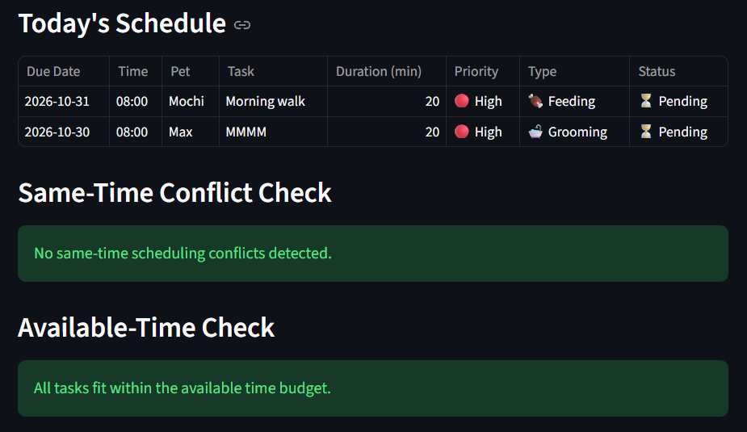

# PawPal+ (Module 2 Project)

You are building **PawPal+**, a Streamlit app that helps a pet owner plan care tasks for their pet.

## Scenario

A busy pet owner needs help staying consistent with pet care. They want an assistant that can:

- Track pet care tasks (walks, feeding, meds, enrichment, grooming, etc.)
- Consider constraints (time available, priority, owner preferences)
- Produce a daily plan and explain why it chose that plan

Your job is to design the system first (UML), then implement the logic in Python, then connect it to the Streamlit UI.

## What you will build

Your final app should:

- Let a user enter basic owner + pet info
- Let a user add/edit tasks (duration + priority at minimum)
- Generate a daily schedule/plan based on constraints and priorities
- Display the plan clearly (and ideally explain the reasoning)
- Include tests for the most important scheduling behaviors

## Getting started

### Setup

```bash
python -m venv .venv
source .venv/bin/activate  # Windows: .venv\Scripts\activate
pip install -r requirements.txt
```

### Suggested workflow

1. Read the scenario carefully and identify requirements and edge cases.
2. Draft a UML diagram (classes, attributes, methods, relationships).
3. Convert UML into Python class stubs (no logic yet).
4. Implement scheduling logic in small increments.
5. Add tests to verify key behaviors.
6. Connect your logic to the Streamlit UI in `app.py`.
7. Refine UML so it matches what you actually built.

## 🖥️ Sample Output

Paste a sample of your app's CLI or Streamlit output here so a reader can see what a generated plan looks like:



## 🧪 Testing PawPal+

Tests:

1. Verifies that task is completed
2. Checks that tasks can be added to pets
3. Checks if tasks are sorted by scheduled time
4. Checks that completeing a daily task creates new instance for it later
5. Checks if tasks with same time/date are detetced correctly

```bash
# Run the full test suite:
pytest

# Run with coverage:
python -m pytest --cov=pawpal_system
```

Sample test output for pytest:

```
================================================ test session starts ================================================
platform win32 -- Python 3.13.15, pytest-9.2.0, pluggy-1.7.0
rootdir: C:\Users\15612\Downloads\ai110-module2show-pawpal-starter
plugins: anyio-4.15.1
collected 5 items

tests\test_pawpal.py .....                                                                                     [100%]

================================================= 5 passed in 0.05s =================================================
```

Sample test output for pytest --cov:

```
================================================ test session starts ================================================
platform win32 -- Python 3.13.15, pytest-9.2.0, pluggy-1.7.0
rootdir: C:\Users\15612\Downloads\ai110-module2show-pawpal-starter
plugins: anyio-4.15.1, cov-7.1.0
collected 5 items

tests\test_pawpal.py .....                                                                                     [100%]

================================================== tests coverage ===================================================
_________________________________ coverage: platform win32, python 3.13.15-final-0 __________________________________

Name               Stmts   Miss  Cover
--------------------------------------
pawpal_system.py      94     19    80%
--------------------------------------
TOTAL                 94     19    80%
================================================= 5 passed in 0.12s =================================================
```

CONFIDENCE LEVEL OUT OF 5 STARS:
I would give this around 4/5 starts, since all the tests were passed. However, additional test may be needed to full verify the functionality of the system.

## 📐 Smarter Scheduling

| Feature           | Method(s)                                                           | Notes                                                                                                                                                                           |
| ----------------- | ------------------------------------------------------------------- | ------------------------------------------------------------------------------------------------------------------------------------------------------------------------------- |
| Task sorting      | `Scheduler.sort_by_time()`                                          | Using `Scheduler.sort_by_time()` to sort tasks by time in ascending order.                                                                                                      |
| Filtering         | `Scheduler.filter_by_status()`, `Scheduler.filter_by_pet()`         | The `Scheduler.filter_by_status()` will return tasks based on the status, if it is complete or not. `Scheduler.filter_by_pet()` will return tasks based on a pet.               |
| Conflict handling | `Scheduler.detect_time_conflicts()`, `Scheduler.detect_conflicts()` | `Scheduler.detect_time_conflicts()` will check if incomplete tasks have same start time and dates. `Scheduler.detect_conflicts()` checks if tasks exceed available time budget. |
| Recurring tasks   | `Scheduler.complete_task()`                                         | `Scheduler.complete_task()` will set task as complete and will create a new instance if it is a recurring task.                                                                 |
| Daily schedule    | `Scheduler.generate_daily_plan()`                                   | `Scheduler.generate_daily_plan()` will display incomplete tasks by scheduled time.                                                                                              |

## 📸 Demo Walkthrough

Describe your app in numbered steps so a reader can follow along without watching a video:

1. Users can add a pet (enter owner name, pet name and species of the pet)
2. Users can add tasks for specific pets
3. Users can scheudle whaever time they want
4. Users can mark as complete, if completed. Note a new task will be automatically created for recurring tasks
5. At the end, users can generate a plan and conflicting times or other warnings will appear, if any.

## Persistence Workflow Feature

When the app starts it will load saved information from before. The infomration is saved on a json file so it is not deleted after each session. If new tasks or pets are added, this information will be saved in the json file.
What I modified:
pawpal_system.py, app.py, data.json, test_persistence.py

## Schudeing Update with Priority

I updated the scheduling to incorporate priorty and time. We see below that the ones with the highest priority are on top. On top of that, we order them in ascending order of time so 8:00 first then 10:00 for highest priorty and then when we get to the medium priority we also sort by ascending order. Look at the example below:

Example CLI Output

```text
PawPal+ Daily Schedule
========================================
Task                Priority    Time
----------------------------------------
Morning Walk        High        08:00
Medication          High        10:00
Feeding             Medium      07:00
Grooming            Low         08:00
========================================
Tasks sorted by priority, then time.
```

## Formatting Features

I updated the app.py and inlcluded the following indicator emojis.

functions used:
format_task_type() , format_priority(), format_status()

Task-Type Emoji: 🐕 Exercise, 🍖 Feeding, 💊 Medication, and 🛁 Grooming.
Priority: 🔴 High, 🟡 Medium, and 🟢 Low
Completion Indicators: ✅ Completed and ⏳ Pending

```

**Screenshot or video** _(optional)_: <!-- Insert a screenshot or link to a demo video here -->
```
